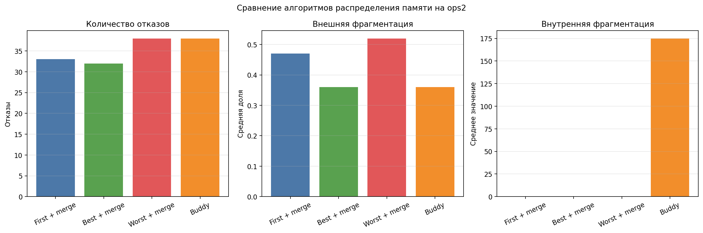

# Практическая работа №9 — распределение памяти

## Цель

Реализовать стратегии непрерывного распределения памяти, исследовать внешнюю и внутреннюю фрагментацию и сравнить их с buddy system и собственным аллокатором.

## Уровень A

`memsim.py` хранит карту памяти как список занятых и свободных блоков. Реализованы `first fit`, `best fit` и `worst fit`.

```bash
python3 run_ops1.py first
python3 run_ops1.py best
python3 run_ops1.py worst
```

Результат на `ops1.txt`:

| Стратегия | Свободно | Максимальная дыра | Дыр | Отказов |
|---|---:|---:|---:|---:|
| first fit | 904 | 250 | 5 | 3 |
| best fit | 624 | 250 | 5 | 2 |
| worst fit | 904 | 250 | 5 | 3 |

Первый отказ `first fit` при достаточном суммарном объёме возникает на операции 8: запрашивается 280 единиц, свободно 554, но самая большая дыра равна 250. Это внешняя фрагментация.

## Уровень B

Добавлены слияние соседних свободных блоков и buddy system. Сравнение на 200 операциях из `ops2.txt`:

| Подход | Отказов | Средняя внешняя фрагментация | Средняя внутренняя фрагментация |
|---|---:|---:|---:|
| first + merge | 33 | 0.47 | 0 |
| best + merge | 32 | 0.36 | 0 |
| worst + merge | 38 | 0.52 | 0 |
| buddy | 38 | 0.36 | 175 |

```bash
python3 compare.py
python3 plot_comparison.py
```



Buddy уменьшает внешнюю фрагментацию, но округляет запросы вверх до степени двойки и поэтому создаёт внутреннюю фрагментацию.

## Уровень C

В `allocator-c/` реализован собственный аллокатор поверх одного `mmap`-региона:

- `my_malloc`, `my_free`, `my_realloc`;
- разбиение и слияние блоков;
- стратегии first fit и best fit;
- метрики времени, RSS и фрагментации;
- сравнение с системным `malloc`.

```bash
cd allocator-c
make clean all
make check
make results
make valgrind
```

Сборка использует `-Wall -Wextra -Werror -pedantic`. Сохранённый прогон Valgrind завершён без утечек и ошибок.

## Вывод

Best fit показал наименьшее число отказов в этой нагрузке, но результат зависит от последовательности запросов. Слияние свободных блоков уменьшает внешнюю фрагментацию. Buddy делает выделение и слияние предсказуемыми, оплачивая это внутренними потерями памяти.
