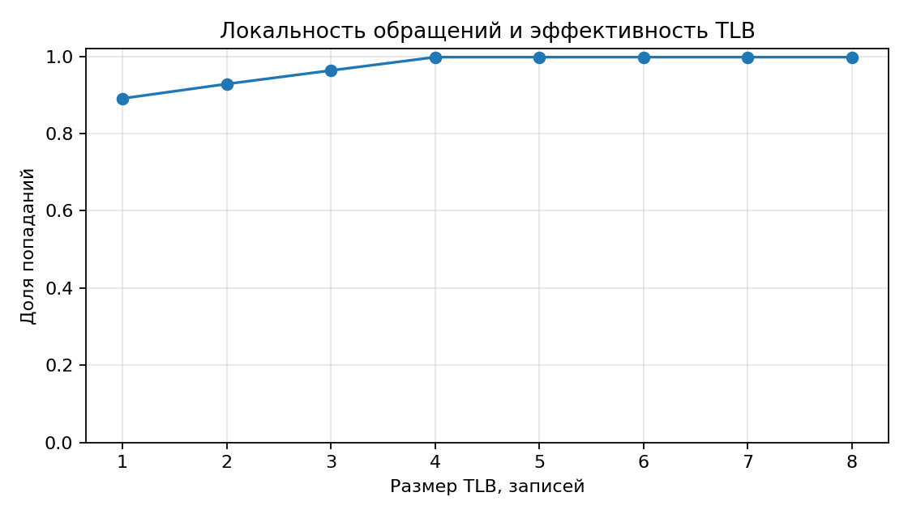

# Практическая работа №10 — страничная организация памяти

## Цель

Реализовать трансляцию логических адресов, смоделировать LRU-TLB и оценить влияние локальности на время доступа.

## Уровень A — трансляция адресов

Размер страницы — 1024 байта. Таблица: `0→5`, `1→2`, `2→7`, `3→0`.

Формулы:

```text
page = address // PAGE_SIZE
offset = address % PAGE_SIZE
physical = frame × PAGE_SIZE + offset
```

Ручная проверка:

| Логический адрес | Страница | Смещение | Кадр | Результат |
|---:|---:|---:|---:|---:|
| 1200 | 1 | 176 | 2 | 2224 |
| 3100 | 3 | 28 | 0 | 28 |
| 5000 | 4 | 904 | — | страница отсутствует |

Размер страницы выбирают степенью двойки, чтобы номер страницы и смещение получать разделением битов адреса без дорогого деления.

## Уровень B — TLB и многоуровневая таблица

`tlb_sim.py` моделирует TLB с политикой LRU, считает hits/misses, EAT и строит график зависимости доли попаданий от размера TLB.

```text
EAT = hit_ratio × (TLB + memory)
    + miss_ratio × (TLB + 2 × memory)
```

При TLB=10 нс и памяти=100 нс:

| Hit ratio | EAT |
|---:|---:|
| 80% | 130 нс |
| 90% | 120 нс |
| 98% | 112 нс |
| без TLB | 200 нс |

`multilevel.py` показывает двухуровневую таблицу. Без TLB одна трансляция требует двух обращений к уровням таблицы и одного обращения к данным.



## Уровень C — реальная система

`memtour.py` показывает размер страницы ОС, виртуальный адрес объекта, номер страницы и смещение. `tlb_stride.c` сравнивает обход памяти с разными шагами.

В Linux аппаратные промахи измеряются отдельно:

```bash
perf stat -e dTLB-loads,dTLB-load-misses ./tlb_stride
```

Чтение `/proc/self/pagemap` для получения физического кадра требует `CAP_SYS_ADMIN`; код не пытается обходить это ограничение.

## Запуск

```bash
python3 -m venv .venv
source .venv/bin/activate
pip install -r requirements.txt
./run_all.sh
```

## Вывод

Страницы устраняют внешнюю фрагментацию, но добавляют таблицы трансляции. TLB компенсирует их стоимость благодаря локальности. Большой шаг обхода ухудшает использование кэша и TLB.
