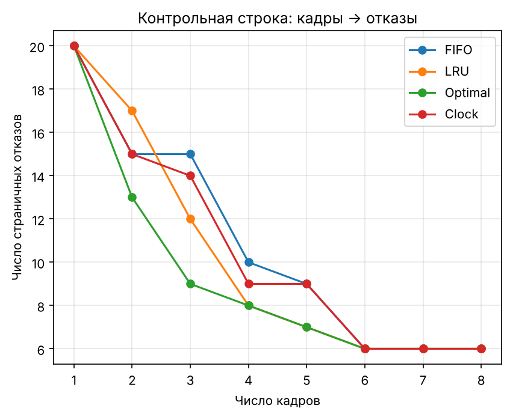

# Практическая работа №11. Алгоритмы замещения страниц

## Цель

Реализовать и сравнить FIFO, LRU, Optimal и Clock, исследовать число отказов страниц и воспроизвести аномалию Белади.

## Запуск

1. `python3 -m venv .venv`
2. `source .venv/bin/activate`
3. `pip install -r requirements.txt`
4. `python3 replace.py`

## Контрольный результат: 3 кадра

| Алгоритм | Отказы |
|---|---:|
| FIFO | 15 |
| LRU | 12 |
| Optimal | 9 |
| Clock | 14 |

Optimal показал минимальное число отказов. Он знает, какая страница понадобится позже всех. В реальной ОС будущее неизвестно, поэтому Optimal используется только как теоретическая нижняя граница.

## Сравнение при 1–8 кадрах

| Кадры | FIFO | LRU | Optimal | Clock |
|---:|---:|---:|---:|---:|
| 1 | 20 | 20 | 20 | 20 |
| 2 | 15 | 17 | 13 | 15 |
| 3 | 15 | 12 | 9 | 14 |
| 4 | 10 | 8 | 8 | 9 |
| 5 | 9 | 7 | 7 | 9 |
| 6 | 6 | 6 | 6 | 6 |
| 7 | 6 | 6 | 6 | 6 |
| 8 | 6 | 6 | 6 | 6 |

При шести кадрах результаты сходятся, потому что в контрольной строке шесть различных страниц.

## Аномалия Белади

| Кадры | FIFO | LRU | Optimal | Clock |
|---:|---:|---:|---:|---:|
| 3 | 9 | 10 | 7 | 9 |
| 4 | 10 | 8 | 6 | 10 |

У FIFO увеличение числа кадров с 3 до 4 увеличило число отказов с 9 до 10. Это аномалия Белади.

У LRU и Optimal такой аномалии нет, потому что это стековые алгоритмы: набор страниц при меньшем числе кадров входит в набор при большем числе кадров.

## Локальность и случайные обращения

| Трасса | FIFO | LRU | Optimal | Clock |
|---|---:|---:|---:|---:|
| Локальная | 193 | 190 | 140 | 191 |
| Случайная | 759 | 743 | 491 | 747 |

При локальности отказов значительно меньше, потому что программа повторно обращается к небольшой группе страниц.

## Алгоритмы

- FIFO вытесняет страницу, загруженную раньше остальных.
- LRU вытесняет страницу, которая дольше всего не использовалась.
- Optimal вытесняет страницу, которая понадобится позже остальных.
- Clock использует бит обращения и циклический указатель, приближая LRU с меньшими затратами.

## Вывод

Optimal даёт лучший результат, но требует знания будущего. LRU эффективен при локальности, но требует учёта обращений. Clock является практичным приближением LRU. FIFO прост, но подвержен аномалии Белади.

## Уровень C: реальные страничные отказы

Программа `faults.c` выделяет большую матрицу, подсчитывает minor и major page faults через `getrusage` и сравнивает обход по строкам и столбцам.

Сборка:

`gcc -Wall -Wextra -O2 -o faults faults.c`

Компиляция выполнена без предупреждений.

### Результаты

| Размер матрицы | Память | Minor при first touch | Major | По строкам | По столбцам | Замедление |
|---:|---:|---:|---:|---:|---:|---:|
| 4096 × 4096 | 64 МиБ | 543 | 0 | 0.007 с | 0.163 с | 24.6 раза |
| 8192 × 8192 | 256 МиБ | 639 | 0 | 0.024 с | 0.705 с | 29.8 раза |

При первом обращении возникают minor faults, потому что `malloc` резервирует виртуальное адресное пространство, а физические страницы подключаются при первом использовании.

Major faults равны нулю, потому что системе хватило оперативной памяти и не потребовалась загрузка страниц с диска или из swap.

Обход по строкам быстрее, поскольку элементы массива находятся в памяти последовательно. При обходе по столбцам адреса резко перескакивают, ухудшается пространственная локальность, увеличивается число промахов кэша и TLB.

Linux приближённо реализует LRU с помощью списков активных и неактивных страниц. В новых версиях ядра также применяется Multi-Gen LRU, который разделяет страницы на поколения по времени последнего использования.

Подробные результаты сохранены в `faults_output.txt` и `faults_large_output.txt`.
